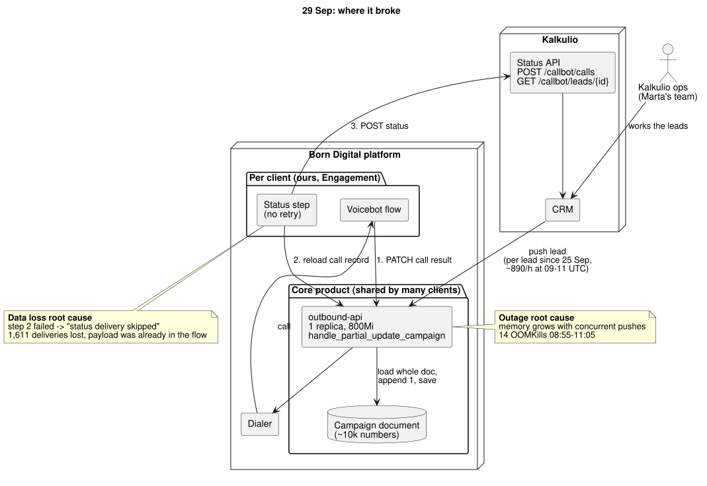

# Kalkulio, 29 Sep incident: work sample

**In short.** Marta's 2,474 is right; the "5,121 status updates" were internal writes, not statuses sent to Kalkulio. An `outbound-api` memory problem, triggered by the switch to real time pushes, broke a status step that had no retry: 1,611 deliveries were lost. The tool below redelivers the newest status of 1,286 leads and deliberately holds back 495, each with a reason. Real exposure is ~5,000 PLN against the 275k claim; we propose waiving the day's attempt fees (9,967.20 PLN). Household can start Monday on conditions; card details on the call are a no.

| File | What |
|---|---|
| [DIAGNOSIS.md](DIAGNOSIS.md) | What happened, the numbers reconciled, fixes with owners |
| [REPLY_TO_MARTA.md](REPLY_TO_MARTA.md) | Reply, ready to send (299 words without the header) |
| [CALL_PLAN.md](CALL_PLAN.md) | Plan for the 10:00 call |
| [BUSINESS.md](BUSINESS.md) | Account value, real exposure, credit note, new asks, contract metrics |
| [NOTES.md](NOTES.md) | Next steps, assumptions, how AI tools were used |
| [docs/USE_CASES.md](docs/USE_CASES.md) | Use cases, user stories with acceptance criteria mapped to tests, diagram index |
| `docs/diagrams/` | PlantUML sources + SVG: incident architecture, incident sequence, target architecture |
| `tools/reconcile.py` | Prints every number used in the documents (`out/reconcile.txt`) |
| `tools/redeliver.py` | The redelivery tool |
| `tools/kalkulio_logs.py` | Log parsing shared by both |
| `tests/` | Plan rules + end to end runs against the real mock |
| `case/` | Copy of the case data, API doc and mock, unchanged |
| `out/` | Outputs of the runs below |

Python 3.10+, stdlib only, macOS or Linux.



## Redelivery tool

```bash
python3 tools/reconcile.py                      # every number in the docs, reads only the logs

python3 case/mock_api/kalkulio_mock.py &        # mock on 127.0.0.1:8099
export KALKULIO_TOKEN=local-test-token

python3 tools/redeliver.py                      # 1. dry run: reads Kalkulio, sends nothing
python3 tools/redeliver.py --apply --limit 50   # 2. canary: the 50 most valuable leads
python3 tools/redeliver.py --apply              # 3. send the rest
python3 tools/redeliver.py --apply              # 4. rerun: sends 0
```

Exit codes: `0` done, `1` stopped early, nothing unsafe sent (the message says whether to rerun later or fix the URL or token first), `2` Kalkulio rejected some items (see the log).

Each run takes ~5.5 min: it GETs every candidate at 4 req/s, with a progress line every 250. To reproduce without touching the submitted outputs, add `--out /tmp/kalkulio-out`; restart the mock to reset its state.

**What it sends.** For each lead, the newest call status in our logs, if that status never reached Kalkulio. Before sending, it GETs the lead from Kalkulio and skips it if Kalkulio already holds that call or a newer one. Interested and callback leads go first.

**What it does not send, and why**

| Reason | Count | Why |
|---|---|---|
| `not_called_yet` | 303 | Pushed too late for the last call before 19:00 Warsaw. Called on 30 Sep, the status flows normally. |
| `superseded_by_newer_attempt` | 185 | Attempt 1 was lost but attempt 2 arrived. Kalkulio shows the status received last, so sending attempt 1 now would overwrite the newer one. |
| `crm_shows_older_status_needs_manual_fix` | 7 | The 13:00 UTC (15:00 Warsaw) manual resend put attempt 1 on top of attempt 2. Resending attempt 2 returns `duplicate` and changes nothing. Kalkulio fixes these by hand (5 of them show a different status). We do not fake timestamps to get past their duplicate check. |
| `already_delivered` / `kalkulio_has_newer_status` | 0 on first run | Safety checks against Kalkulio's live state. On a rerun everything lands in `already_delivered`. |
| `already_correct_in_kalkulio` | 0 so far | One of the 7 manual fixes that Kalkulio has already set by hand. |

**Safety.** Dry run unless `--apply`. Token only from the environment. A preflight GET stops the run on a wrong URL or token, instead of reporting "nothing to send". An OS lock (`flock`) stops two runs at once and is released even if the process is killed. At most 50 items per request and 4 requests per second (the API allows 5). `429` waits `Retry-After`; `503` and network errors back off exponentially, up to 6 retries, then the run stops and can be started again. Other 4xx are not retried. Retrying is safe because Kalkulio dedupes on `assignmentId` + `callInitDatetime`. Each run writes a plan CSV (a dry run also writes the client file) and appends every POST and per item result to `out/redeliver_log.jsonl`.

## Tests

```bash
python3 -m unittest discover -s tests -v       # ~40 s
```

Unit tests cover the plan rules and `decide`. The end to end tests start the real mock in process with 20 % of POSTs answered `503`, send faster than its rate limit, and check: the dry run sends nothing; a canary sends exactly 50; apply leaves every lead on its newest status except the 7 manual fixes; nothing is rejected; 429 and 503 retries really ran; the rerun sends nothing; a wrong base URL exits 1; a second run is blocked by the lock.

## Output of the runs against the mock

The mock was started fresh before run 1 (`out/mock_stdout.txt`: 2,474 leads with a status). Full outputs are in `out/run*.txt`, every POST and per item result in `out/redeliver_log.jsonl`. The dry run also writes `out/for_kalkulio.csv`, the file promised to Marta: the 1,286 missing results and the 7 leads to fix by hand, in their API's field names; it is built from the logs, so later runs and `--limit` do not change it. `out/redeliver_plan_*.csv` list every lead the tool sends or holds back (1,781 of 4,000; the rest are fine), with the reason; the apply plan is overwritten on each run. Progress lines are cut below.

**1. Dry run** (`out/run1_dry_run.txt`)

```
$ python3 tools/redeliver.py
redeliver 20261109T125750Z-3f30b4  mode: DRY RUN (nothing will be sent)  api: http://127.0.0.1:8099
logs: 4000 leads, 3697 called, 1286 with newest status missing per logs
  ...
PLAN
  send: 1286  by status: {'ANSWERED_NOT_INTERESTED': 419, 'ANSWERED_INTERESTED': 309, 'NO_ANSWER': 195, 'VOICEMAIL': 169, 'CALLBACK_REQUESTED': 95, 'BUSY': 53, 'WRONG_NUMBER': 46}
  not sending:
      303  not_called_yet
      185  superseded_by_newer_attempt
        7  crm_shows_older_status_needs_manual_fix
  ask Kalkulio to set these by hand (a resend would only be a 'duplicate'):
    A-100679: should be ANSWERED_INTERESTED (call 2026-09-29T11:04:53.252Z)
    A-100695: should be NO_ANSWER (call 2026-09-29T11:10:39.467Z)
    A-100710: should be NO_ANSWER (call 2026-09-29T11:05:37.441Z)
    A-100746: should be CALLBACK_REQUESTED (call 2026-09-29T11:15:03.258Z)
    A-100805: should be ANSWERED_NOT_INTERESTED (call 2026-09-29T11:16:54.394Z)
    A-100811: should be CALLBACK_REQUESTED (call 2026-09-29T11:02:26.163Z)
    A-100820: should be ANSWERED_INTERESTED (call 2026-09-29T11:05:06.479Z)

Dry run. Rerun with --apply to send.
plan: out/redeliver_plan_dry_run.csv
log:  out/redeliver_log.jsonl
file for Kalkulio: out/for_kalkulio.csv
(exit 0)
```

**2. Canary** (`out/run2_canary.txt`)

```
$ python3 tools/redeliver.py --apply --limit 50
  ...
PLAN
  send: 50  by status: {'ANSWERED_INTERESTED': 50}
  not sending:
     1236  held_back_by_limit
      303  not_called_yet
      185  superseded_by_newer_attempt
        7  crm_shows_older_status_needs_manual_fix
  ...
RESULT  {'accepted': 50}   retries: none
(exit 0)
```

**3. Apply** (`out/run3_apply.txt`)

```
$ python3 tools/redeliver.py --apply
  ...
PLAN
  send: 1236  by status: {'ANSWERED_NOT_INTERESTED': 419, 'ANSWERED_INTERESTED': 259, 'NO_ANSWER': 195, 'VOICEMAIL': 169, 'CALLBACK_REQUESTED': 95, 'BUSY': 53, 'WRONG_NUMBER': 46}
  not sending:
      303  not_called_yet
      185  superseded_by_newer_attempt
       50  already_delivered
        7  crm_shows_older_status_needs_manual_fix
  ...
RESULT  {'accepted': 1236}   retries: none
(exit 0)
```

**4. Apply again: nothing re-sent** (`out/run4_apply_again.txt`)

```
$ python3 tools/redeliver.py --apply
  ...
PLAN
  send: 0  by status: {}
  not sending:
     1286  already_delivered
      303  not_called_yet
      185  superseded_by_newer_attempt
        7  crm_shows_older_status_needs_manual_fix
  ...
RESULT  nothing sent   retries: none
(exit 0)
```
